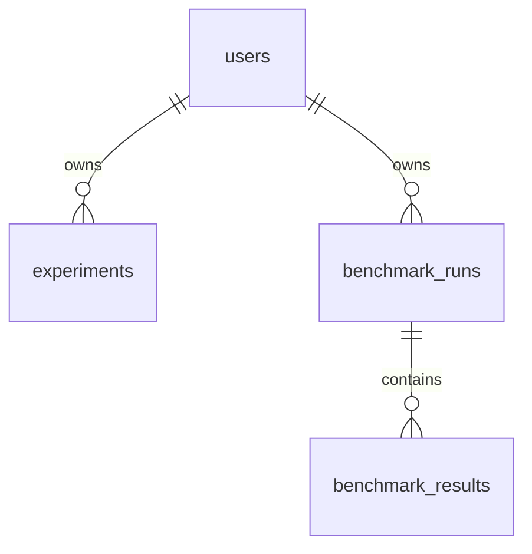

# AlgoLab

**정렬 알고리즘 시각화 및 성능 비교 학습 플랫폼**

AlgoLab은 정렬 알고리즘의 동작 원리를 직관적으로 이해하고, 동일한 입력 조건에서 알고리즘별 성능을 비교할 수 있도록 개발한 JSP 기반 웹 애플리케이션입니다. 이론과 코드로만 학습하던 정렬 과정을 시각화하고, 실험 결과를 개인 계정에 저장하여 다시 확인할 수 있습니다.

웹프로그래밍 교과목의 최종 프로젝트로 개발하였습니다.

## 1. 주요 기능

- **정렬 시각화**: Bubble, Selection, Insertion, Merge, Quick Sort의 단계별 동작을 애니메이션으로 표현합니다. 재생, 일시정지, 이전·다음 단계 이동, 속도 조절 및 초기화를 지원합니다.
- **배열 입력 및 파일 업로드**: 1~30개의 정수를 직접 입력하거나 TXT·CSV 파일(최대 16KB)에서 불러올 수 있습니다.
- **성능 비교**: 동일한 입력 배열로 5가지 정렬 알고리즘을 실행하고 평균 실행 시간, 비교 횟수, 교환·이동 횟수를 표로 비교합니다.
- **회원 관리**: 회원가입, 로그인, 로그아웃을 지원하며 세션으로 로그인 상태를 유지합니다.
- **내 실험 기록**: 시각화 및 성능 비교 결과를 MySQL에 저장하고, 본인의 기록만 조회하거나 삭제할 수 있습니다. 저장된 시각화 실험은 다시 실행할 수 있습니다.
- **사용자 편의 기능**: 최근 실행한 알고리즘을 30일간 쿠키에 저장하며, 한국어·영어 전환을 지원합니다.

로그인하지 않아도 정렬 시각화와 성능 비교를 이용할 수 있습니다. 실험 기록의 저장·조회·삭제는 로그인한 회원만 이용할 수 있습니다.

## 2. 개발 환경

| 구분 | 사용 기술 |
| --- | --- |
| Language | Java (JDK 20.0.1) |
| Backend | JSP, Jakarta Servlet, JDBC |
| Frontend | HTML5, CSS3, JavaScript |
| Web Server / WAS | Apache Tomcat 10.1 |
| Database | MySQL 8.x |
| JDBC Driver | MySQL Connector/J 8.x 이상 |
| IDE | Eclipse IDE for Enterprise Java and Web Developers |
| Version Control | Git, GitHub |

## 3. 정렬 알고리즘 구현

| 알고리즘 | 최선 | 평균 | 최악 | 시각화 방식 |
| --- | --- | --- | --- | --- |
| Bubble Sort | O(n²) | O(n²) | O(n²) | 인접 원소의 비교와 교환 |
| Selection Sort | O(n²) | O(n²) | O(n²) | 최솟값 후보 탐색 및 위치 확정 |
| Insertion Sort | O(n) | O(n²) | O(n²) | Key 선택, 원소 이동 및 삽입 |
| Merge Sort | O(n log n) | O(n log n) | O(n log n) | 분할 트리와 단계별 병합 그래프 |
| Quick Sort | O(n log n) | O(n log n) | O(n²) | Pivot 선택 및 부분 배열 분할 |

위 시간복잡도는 본 프로젝트에서 사용한 정렬 로직 자체를 기준으로 하며, 시각화용 단계 기록 비용은 포함하지 않습니다.

### 구현상의 특징

- **Bubble Sort**: 조기 종료 최적화 없이 인접 원소를 비교하는 기본 형태를 사용합니다.
- **Insertion Sort**: 인접 교환이 아닌 Key와 Shift 기반으로 구현하였습니다. 화면에서는 Key가 최종 삽입 위치로 한 번에 이동하도록 표현하지만 실제 비교 및 Shift 횟수는 별도로 집계합니다.
- **Merge Sort**: 분할 트리를 유지하면서 병합 대상과 임시 배열을 막대그래프로 표시합니다. 병합 결과가 부모 노드에 순차적으로 반영되도록 구성하였습니다.
- **Quick Sort**: Lomuto 분할 방식을 사용하며, 각 정렬 구간의 마지막 원소를 Pivot으로 선택합니다. Pivot 이하의 원소와 큰 원소를 분리하고 나머지 구간을 정렬합니다. 학습자가 기본 분할 과정을 이해하기 쉽도록 해당 방식을 채택하였으며, 정렬된 배열이나 역순 배열에서는 최악 O(n²)이 발생할 수 있습니다.

### 성능 비교 방식

- 배열 크기: 10~5,000개
- 입력 형태: 무작위, 오름차순, 내림차순, 거의 정렬된 배열
- 측정 횟수: 1, 3, 5, 10회

성능 측정은 시각화용 `SortStep`을 생성하지 않는 독립적인 Java 정렬 로직에서 수행합니다. 각 회차에서 Java가 생성한 동일한 원본 배열을 알고리즘마다 복사하여 전달합니다. 고정 난수 시드를 사용하여 동일 조건의 입력을 재현할 수 있습니다.

JVM 워밍업 후 `System.nanoTime()`을 이용하여 측정하며, 실행 순서를 회차별로 교대합니다. 배열 생성·입력 복사·정렬 결과 검증은 측정 구간에서 제외합니다. 측정값에는 연산 횟수 집계 비용이 포함되며 JVM 및 실행 환경에 따라 달라질 수 있습니다.

교환·이동 횟수는 알고리즘별로 의미가 다릅니다. Bubble/Selection/Quick은 실제 교환, Insertion은 오른쪽 Shift, Merge는 임시 배열에 원소를 배치한 횟수를 기록합니다. 따라서 해당 횟수만으로 알고리즘의 절대적인 성능 순위를 판단하지 않습니다.

## 4. 프로젝트 구조

```text
AlgoLab/
├── database/
│   └── schema.sql                 # 초기 데이터베이스 생성
├── examples/                      # TXT·CSV 예제 배열
├── src/main/
│   ├── java/com/algolab/
│   │   ├── algorithm/             # 정렬 알고리즘 5종
│   │   ├── auth/                  # 회원 인증 및 비밀번호 해시
│   │   ├── benchmark/             # 성능 비교 및 측정 결과
│   │   ├── dao/                   # JDBC 데이터베이스 접근
│   │   ├── dto/                   # 실험 및 정렬 단계 데이터
│   │   ├── i18n/                  # 한국어·영어 메시지
│   │   ├── service/               # 시각화 및 실험 처리
│   │   ├── servlet/               # 배열 파일 업로드
│   │   └── util/                  # DB 연결, 쿠키, 토큰 등
│   └── webapp/
│       ├── index.jsp              # 메인 화면 및 배열 입력
│       ├── visualizer.jsp         # 정렬 시각화
│       ├── benchmark.jsp          # 성능 비교
│       ├── history.jsp            # 내 실험 기록
│       ├── experiment.jsp         # 시각화 기록 상세
│       ├── benchmarkDetail.jsp    # 성능 비교 기록 상세
│       ├── login.jsp              # 로그인
│       ├── signup.jsp             # 회원가입
│       ├── menu.jsp               # 공통 메뉴
│       ├── resources/             # CSS 및 JavaScript
│       └── WEB-INF/
│           └── db.properties.example
├── .classpath
├── .project
├── .gitignore
└── README.md
```

## 5. 데이터베이스 설계

| 테이블 | 역할 |
| --- | --- |
| `users` | 회원 아이디, 이름, 비밀번호 해시 저장 |
| `experiments` | 시각화 입력 배열, 제목, 연산 횟수, 메모, 작성자 저장 |
| `benchmark_runs` | 성능 비교 실험 제목, 배열 조건, 반복 횟수, 작성자 저장 |
| `benchmark_results` | 알고리즘별 평균 실행 시간 및 연산 횟수 저장 |



`user_id`를 기준으로 회원별 기록을 관리하며, 서버에서 로그인한 회원의 ID를 확인하여 타인의 기록에 대한 조회와 삭제를 제한합니다. `UNIQUE(user_id, title)`을 통해 동일한 회원의 동일 종류 실험 기록에서 제목 중복을 방지합니다. 성능 비교 실험을 삭제하면 관련 측정 결과도 외래키의 `ON DELETE CASCADE`에 의해 삭제됩니다.

기존 버전에서 작성자 없이 생성한 기록은 `user_id`가 NULL인 상태로 보존되며, 소유자가 배정되기 전까지 일반 사용자 화면에 표시되지 않습니다.

## 6. 실행 방법

### 6-1. 프로젝트 가져오기

1. GitHub 저장소의 **Code → Download ZIP**을 선택하여 압축을 해제하거나 Git으로 저장소를 Clone합니다.
2. Eclipse에서 **File → Import → General → Existing Projects into Workspace**를 선택합니다.
3. AlgoLab 프로젝트 폴더(`.project` 파일이 있는 위치)를 선택하여 가져옵니다.
4. JDK 20을 설정하고 Apache Tomcat 10.1을 서버로 등록합니다.

### 6-2. 데이터베이스 생성

MySQL Server를 실행하고 MySQL Workbench 또는 MySQL 콘솔에서 [`database/schema.sql`](database/schema.sql)을 실행합니다.

명령줄에서 실행할 경우 프로젝트 루트에서 다음 명령어를 사용할 수 있습니다.

```bash
mysql -u root -p < database/schema.sql
```

`algolab` 데이터베이스와 4개의 테이블이 생성됩니다.

```sql
USE algolab;
SHOW TABLES;
```

이 스크립트는 최신 버전의 신규 설치용입니다. 기존 테이블을 삭제하거나 변경하지 않으므로, 이전 버전의 DB를 사용 중이라면 기존 데이터를 백업한 후 필요한 마이그레이션을 별도로 수행해야 합니다.

### 6-3. DB 접속 정보 설정

`src/main/webapp/WEB-INF/db.properties.example`을 같은 폴더에 `db.properties`라는 이름으로 복사합니다.

각자의 MySQL 계정 및 비밀번호에 맞게 설정합니다.

```properties
db.url=jdbc:mysql://localhost:3306/algolab
db.user=root
db.password=YOUR_MYSQL_PASSWORD
```

위 `root`는 로컬 실습용 예시입니다. 별도 MySQL 계정을 사용하는 경우 해당 계정으로 변경합니다. 실제 접속 정보가 포함된 `db.properties`는 `.gitignore`에 의해 Git 추적 대상에서 제외됩니다.

### 6-4. JDBC 드라이버 추가

1. [MySQL Connector/J 공식 다운로드 페이지](https://dev.mysql.com/downloads/connector/j/)에서 Connector/J를 내려받습니다.
2. 압축을 해제하고 `mysql-connector-j-*.jar`를 `src/main/webapp/WEB-INF/lib/`에 넣습니다. 폴더가 없으면 생성합니다. 이미 드라이버가 있는 경우 중복 추가하지 않습니다.
3. Eclipse의 Java Build Path와 Deployment Assembly에서 웹 애플리케이션에 드라이버가 포함되는지 확인합니다.

### 6-5. Tomcat 실행

1. Eclipse의 프로젝트 속성에서 `src/main/java`가 Java 소스 폴더인지 확인합니다. Deployment Assembly는 Java 빌드 결과가 `/WEB-INF/classes`, `src/main/webapp`이 웹 애플리케이션 루트(`/`)로 배포되도록 설정합니다.
2. 프로젝트를 Refresh(F5)하고 **Project → Clean**을 실행합니다.
3. Servers 탭에서 Tomcat 10.1에 AlgoLab 프로젝트를 추가하고 실행합니다.
4. 브라우저에서 다음 주소에 접속합니다. 기본 컨텍스트 경로(`/AlgoLab`)와 포트(8080)를 기준으로 하며, 설정이 다르면 주소를 변경합니다.

```text
http://localhost:8080/AlgoLab/index.jsp
```

연결 확인이 필요하면 로컬 개발 환경에서 `http://localhost:8080/AlgoLab/dbTest.jsp`에 접속합니다.

**오류 해결**: JSP에서 Java 클래스를 찾지 못하거나 변경 사항이 반영되지 않는 경우 프로젝트의 Refresh → Clean, Tomcat의 Clean → Publish → 재시작 순으로 확인합니다. `ResourceBundle` 오류가 발생하면 `messages_ko.properties`, `messages_en.properties`가 `/WEB-INF/classes/com/algolab/i18n/`에 배포되었는지 확인합니다. DB 연결 오류가 발생하면 MySQL 실행 여부, 접속 설정 및 JDBC 드라이버 배포 상태를 확인합니다.

## 7. JSP 수업 기술 적용

| 평가 요소 | 적용 내용 |
| --- | --- |
| 스크립트 태그 | JSP 스크립틀릿 및 표현식으로 요청 처리와 동적 화면 출력 |
| 디렉티브 태그 | `page` 디렉티브로 인코딩, 콘텐츠 유형 및 Java 클래스 import 지정 |
| 액션 태그 | `jsp:include`로 공통 메뉴 재사용 |
| 내장 객체 | `request`, `response`, `session`, `application`을 통한 요청·응답 및 상태 관리 |
| 폼 태그 | 배열 입력, 파일 업로드, 실험 검색·저장, 로그인·회원가입 |
| 파일 업로드 | `multipart/form-data` 및 Jakarta Servlet의 `Part` 활용 |
| 유효성 검사 | HTML·JavaScript 입력 검사, Java 서버 검증, DB 고유 제약조건 |
| 다국어 처리 | `ResourceBundle`과 한국어·영어 메시지 파일 활용 |
| 세션 | 로그인 상태, 언어 설정, 실험 데이터 및 요청 검증 토큰 관리 |
| 쿠키 | 최근 실행한 정렬 알고리즘 저장 및 자동 선택 |
| 데이터베이스와 JSP 연동 | JDBC, DAO, `PreparedStatement`를 이용한 회원 및 실험 기록 관리 |

## 8. 보안 및 프로젝트 범위

- 비밀번호는 JDK의 PBKDF2-HMAC-SHA256과 사용자별 Salt로 해시하여 저장합니다.
- DB 쿼리는 `PreparedStatement`로 파라미터를 바인딩하며, 기록 저장·삭제 과정에서 로그인 상태와 요청 검증 토큰을 확인합니다.
- 실험 기록의 소유자 검사는 서버에서 수행합니다. 다른 회원의 기록 번호로 직접 접근하는 경우에도 조회·삭제를 제한합니다.
- 본 프로젝트는 로컬 학습 및 과제 시연 환경을 기준으로 개발하였습니다. 외부 웹호스팅 시 HTTPS, 로그인·회원가입 요청 제한, 운영 DB 계정의 최소 권한 설정, 개발용 `dbTest.jsp` 제거 또는 접근 제한 등의 추가 보안 설정이 필요합니다.
- MySQL에 저장된 실험 기록과 계정 정보는 Git으로 동기화되지 않습니다. 실제 DB 접속 정보와 데이터 백업 파일은 공개 저장소에 포함하지 않습니다.
